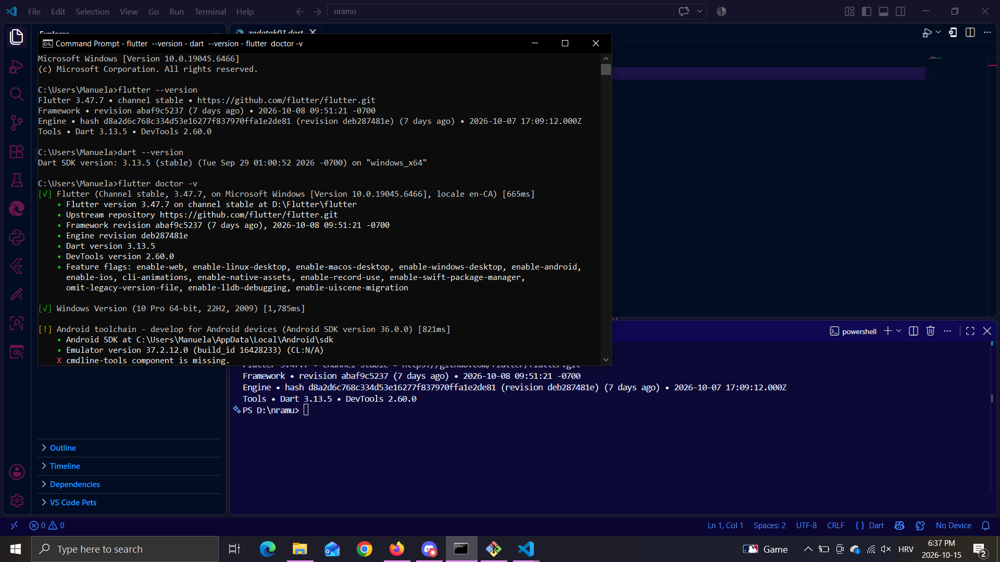
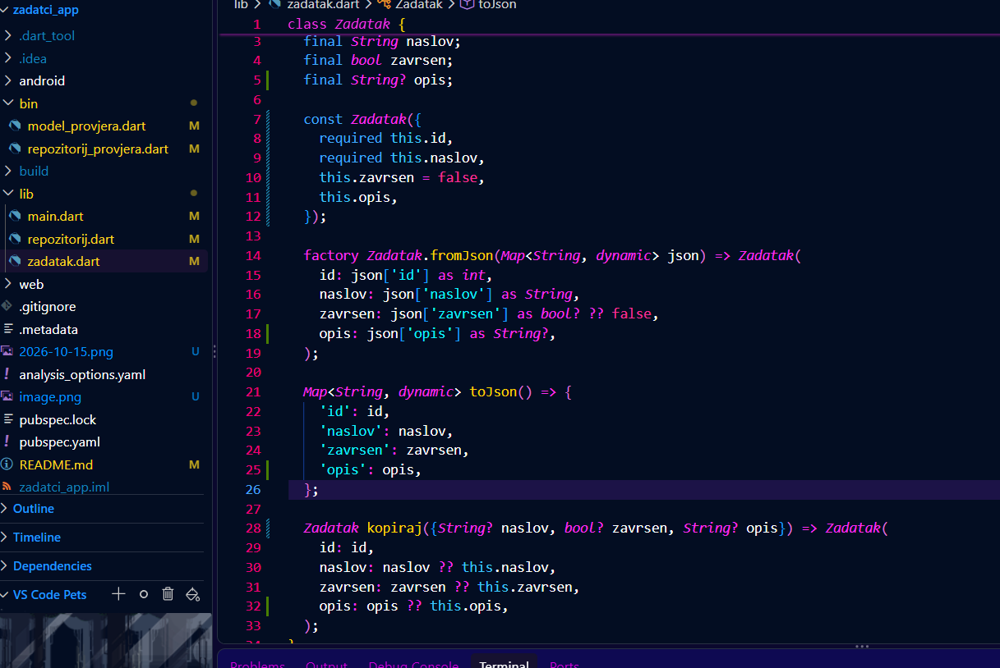
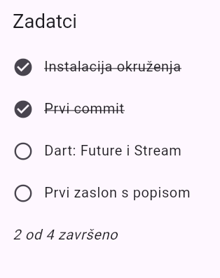
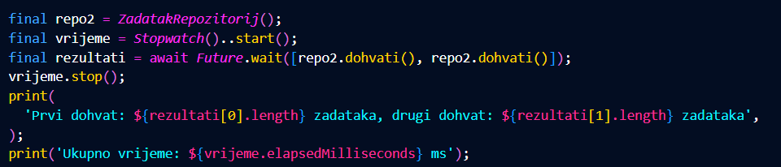
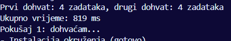
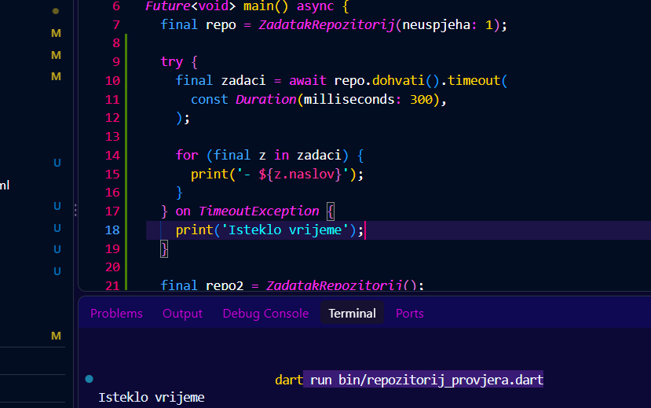
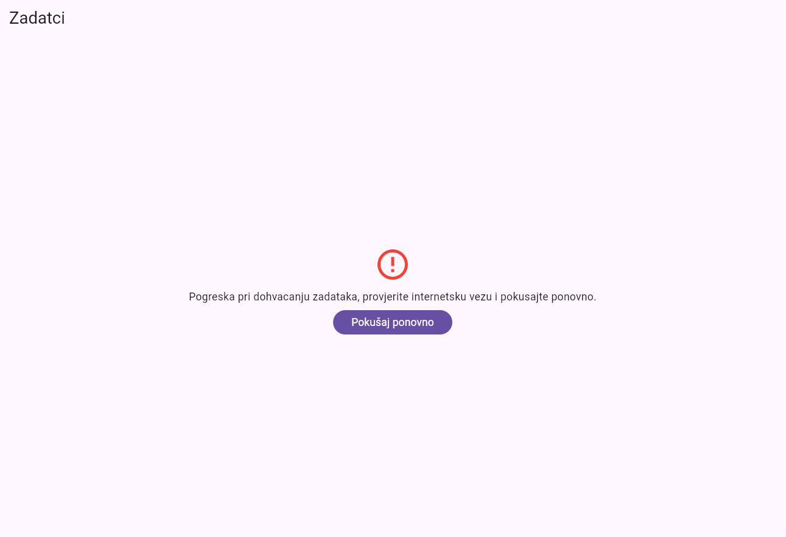

# zadatci_app

## Manuela Kurtović

### Operacijski sustav:
 Windows 10 Pro

### Verzije Fluttera i Darta:
Flutter 3.47.7 • channel stable • https://github.com/flutter/flutter.git
Framework • revision abaf9c5237 (7 days ago) • 2026-10-08 09:51:21 -0700
Engine • hash d8a2d6c768c334d53e16277f837970ffa1e2de81 (revision deb287481e) (8 days ago) • 2026-10-07 17:09:12.000Z
Tools • Dart 3.13.5 • DevTools 2.60.0

Dart SDK version: 3.13.5 (stable) (Tue Sep 29 01:00:52 2026 -0700) on "windows_x64"

### Korišteni uređaj:
Chrome i na Android Studiu odabran Pixel 10a - Android 17.0

### Provedene izmjene i odgovori na pitanja:
Odgovori na pitanja:
1. Polja modela definirana su kao final zbog čega se njihove vrijednosti ne mogu mijenjati nakon stvaranja objekta, što sprječava slučajne promjene podataka. Za promjenu vrijednosti može se koristiti metoda kopiraj, koja stvara novi objekt s izmijenjenim podacima.
Ako u JSON-u ne postoji polje naslov,a metoda fromJson koristi json['naslov'] as String, njegova će vrijednost biti null. Null se ne može pretvoriti u String,pa će program baciti iznimku tijekom izvođenja. To se spriječava provjerom postoji li polje ili definiranjem prikladne zadane vrijednosti.
2. Ako Future završi s pogreškom, a mi je ne uhvatimo pomoću 'try-catch' bloka, ta pogreška će ostati neobrađena. Zbog toga se može pojaviti poruka o neobrađenoj asinkronoj pogreški, a u nekim slučajevima može doći i do prekida rada dijela programa ili rušenja aplikacije.
3. Future se stvara u polju, a ne u metodi build, jer se metoda build može pozivati više puta. Ako bi se Future nalazio unutar te metode, podaci bi se svaki put iznova dohvaćali, što nije potrebno. Kada se Future stvori u polju, dohvaćanje se ne ponavlja pri svakom izgrađivanju zaslona, nego samo kada ga ponovno pozovemo, na primjer klikom na gumb za ponovni pokušaj.
Svaki zaslon koji prikazuje podatke treba imati tri stanja:
  Učitavanje (prikazuje se indikator dok se podaci dohvaćaju)
  Pogreška (prikazuje se poruka ako dohvaćanje podataka ne uspije)
  Uspjeh (prikaz dohvaćenih podaci, ako je popis prazan prikazuje se poruka da nema podataka)

Izmjene: 
Prvi zadatak- Dodavanje polja String?:   
final String? opis;
konstruktor:
const Zadatak({required this.id, required this.naslov, this.zavrsen = false, this.opis});
fromJson dodana linija:
    opis: json['opis'] as String?,
toJson dodana linija:
    'opis': opis,
kopiraj dodana linija:
    opis: opis ?? this.opis
 
 

Drugi zadatak- Dodan opis zadatka 2:   { "id": 2, "naslov": "Git", "opis": "neki opis zadatka"},
Ako se ispisuje opis onog zadatka koji ga ima, ispisat ce se prava vrijednost, no ispisivanjem opisa zadatka koji nema opis ispiše se samo null.
  
 
Treći zadatak - 
  
Future.wait pokreće dva dohvati() istovremeno, vrijeme se mjeri pomoću Stopwatch(). Iako pojedini poziv traje 800ms, budući da ih Future.wait pozove istoremeno, ukupno trajanje je oko 800ms.
Četvrti zadatak - Poziv dohvati() omota se metodom .timeout() s ograničenjem od 300 ms. Budući da dohvat traje oko 800 ms, nastaje TimeoutException, koju hvatamo i ispisujemo poruku: Isteklo vrijeme. final repo = ZadatakRepozitorij(neuspjeha: 1);
 

  
Peti zadatak - Izmjena poruke pogreške: Text('Pogreska pri dohvacanju zadataka, provjerite internetsku vezu i pokusajte ponovno.'),
Kada bismo u liniji   final _repo = ZadatakRepozitorij(neuspjeha: 0, prazno: false);
za broj neuspjeha stavili 1:
 

 
Šesti zadatak - Dodavanje teksta o završenim zadacima ispod popisa:
 final brojZavrsenih = zadaci.where((z) => z.zavrsen).length;

          if (i== zadaci.length) {
            return ListTile(
              title: Text(
                '$brojZavrsenih od ${zadaci.length} završeno',
                style: const TextStyle(fontStyle: FontStyle.italic),
              ),
            );
          }
 
 
Sedmi zadatak - return RefreshIndicator(
      onRefresh: () async {
      setState(() {
        _buduci = _repo.dohvati();
      });

      await _buduci;
    }, 
    child: ListView.builder(...

