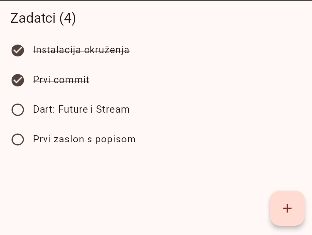
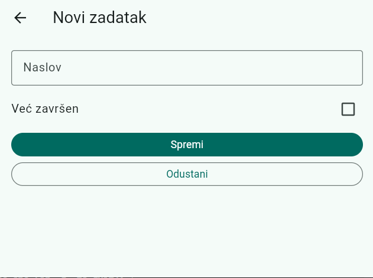
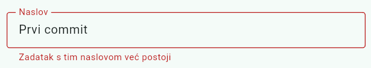
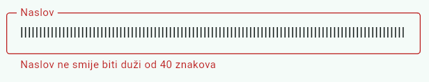
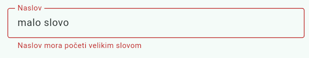

# zadatci_app

## Manuela Kurtović

### Provedene izmjene i odgovori na pitanja:
Odgovori na pitanja:
1. Zadavanje boje u temi je bolje od zadavanja boje u pojedinom widgetu jer je onda, prilikom promjene boje, potrebno promijeniti samo temu, a ne tražiti za svaki widget dio gdje smo zadali boju. To isto čini kiod kraćim i čitljivijim.
2. Metoda validate() se poziva unutar forme za provjeru tekstualnih polja. A ko unutar forme postoji više tekstualnih polja metoda validate prolazi kroz svaki od njih i provjerava ih, samo u slučaju da su sva polja prošla provjeru veće true, ako ijedno polje ima neispravan unus vraća false. Validator mora vratiti null ili poruku o grešci, tu null označava odsutstvo problema/greške.
3. Nakon await Navigator.push provjerava mounted kako bi bio siguran da ekran postoji, to jest da nije u međuvremenu uništen. Dok na ekranu s formom korisnih unese podatke, na prvom ekranu se moglo nešto izmijeniti da dovede do toga da taj ekran više ne postoji u memoriji. To bi uzrokovalo da mounted poprimi vrijednost false, te, ako se kod nastavi izvršavati može doći do rušenja aplikacije. 

Izmjene:
1. Izmjena boje: postavljanjem teme na deepOrange dobijemo 
2. Prikaz broja zadataka u naslovu ostvaren je promjenom sljedeće linije koda:
<code> appBar: AppBar(title: Text('Zadatci (${_zadaci.length})')),
</code>
Kako bi se broj zadataka u naslovu mogao promijeniti kada se doda novi zadatak izbrisano je 'const' ispred Text-a, te je dodan setState(())unutar kojeg je već postojeći kod: 
<code>
_zadaci
    ..clear()
    ..addAll(podaci);
</code>
što izgleda ovako:
<code>
setState(() {
      _zadaci
        ..clear()
        ..addAll(podaci);
    });
</code>
Rezultat tog koda vidljiv je na prethodnoj slici.
3. Gumb 'Odustani' dodaj je na sljedeći način:
unutar Scaffold-a, ispod već postojećeg button-a za spremanje dodan je sljedeći kod:
<code>
const SizedBox(height: 8),
            OutlinedButton(onPressed: _odustani, child: const Text('Odustani')),
</code>
također je dodano:
<code>
void _odustani() {
    Navigator.pop(context);
  }
  </code>
  

4. Provjera duplikata naslova:
<code>
 if(widget.postojeci.any((z) => z.naslov == tekst)) {
      return 'Zadatak s tim naslovom već postoji';
    }
</code>

5. Provjera broja znakova u naslovu:
<code>
    if(tekst.length > 40) return 'Naslov ne smije biti duži od 40 znakova';
</code>

6. Provjera počinje li naslov velikim slovom:
<code>
    if(tekst[0] != tekst[0].toUpperCase()) return 'Naslov mora početi velikim slovom';

</code>

